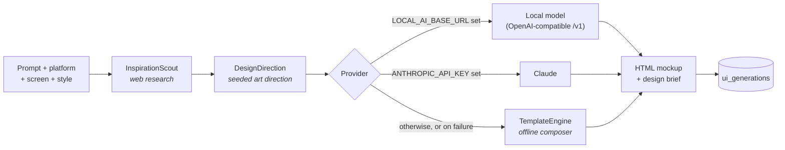

<div align="center">

# UISpark

**A UI inspiration gallery with a research-driven mockup generator.**

Describe a product in any domain — plumbing, pharmacy, fintech, farming — and UISpark designs
a single-file HTML screen for it, grounded in real interface references gathered from the web.

[](https://github.com/BzSiam25/UI-Suggester/actions/workflows/ci.yml)
[](LICENSE)
[](https://www.php.net/)
[](https://laravel.com/)
[](https://react.dev/)
[](https://vite.dev/)

[Features](#features) · [How it works](#how-generation-works) · [Getting started](#getting-started) · [Configuration](#configuration) · [API](docs/API.md) · [Architecture](docs/ARCHITECTURE.md) · [Contributing](CONTRIBUTING.md)

</div>

---

## Overview

UISpark is a two-part application:

- **A community gallery of real UI screens** — browse by domain, platform, screen type and colour,
  filter and search, like, bookmark into collections, and discuss in threaded comments.
- **A mockup generator** — give it a prompt, get a working page you can preview, open, download
  and share. Every run starts with a web lookup for interface references and then picks a fresh
  art direction, so the same prompt does not return the same page twice.

No API keys are required to run it: the built-in template engine composes mockups offline.
Add a local model or a Claude key to have a model design them instead.

## Features

| Area | Highlights |
|---|---|
| **Explore** | Gallery of approved screens, filtered by domain, platform (web/mobile/tablet), screen type, dominant colour, tag; sorts for latest, trending, popular and most viewed |
| **Generator** | Research → art direction → layout composition; 18 screen types, 6 visual styles, 8 design languages; returns a self-contained HTML page plus the design brief that produced it |
| **Community** | Upload screenshots (moderated before publication), likes, bookmarks with named collections, one-level threaded comments, tags created on the fly |
| **Colour extraction** | Palettes sampled from every upload with GD, merged perceptually, named into colour families for filtering, shown as click-to-copy swatches |
| **Accounts** | Token auth via Sanctum, profile editing, role-based admin access, user suspension |
| **Admin** | Dashboard stats, moderation queue with rejection reasons, user management, domain management |
| **Shareable output** | Public showcase of shared mockups, raw HTML endpoint, sandboxed preview iframe |

## Tech stack

| Layer | Choice |
|---|---|
| API | PHP 8.2+, Laravel 12, Sanctum, MySQL 8 (SQLite in tests) |
| Web app | React 18, React Router 6, Vite 5, hand-written CSS |
| Generation | Pluggable provider: local OpenAI-compatible server (Qwen), Anthropic Claude, or the built-in PHP template engine |
| Research | Exa Search API when a key is configured, keyless HTML search otherwise, curated reference gallery as the last resort |

## How generation works



1. **Research** — `InspirationScout` turns the prompt into a search query, asks Exa (or a keyless
   endpoint) for real UI references, caches the board for six hours, and falls back to a curated
   gallery when the network is unavailable.
2. **Direction** — `DesignDirection` seeds an art direction from the prompt: one of eight design
   languages (editorial, Swiss, quiet minimal, soft SaaS, console, glass neon, pop, craft), plus
   typography, radius, accent and a layout recipe. The recipe shuffles hero, proof, benefits,
   showcase, closing and footer variants, so repeated prompts diverge.
3. **Composition** — the direction and the reference board become a design brief. A configured
   model writes the page; if it fails, `TemplateEngine` composes the same direction in PHP and the
   response carries a notice explaining the fallback.
4. **Persistence** — the HTML and a `meta.design` payload (direction, recipe, research source and
   references) are stored, so the UI can show what inspired each result.

Details and extension points: [docs/ARCHITECTURE.md](docs/ARCHITECTURE.md).

## Repository layout

```
uispark/
├── backend/                  Laravel API (http://localhost:8000/api)
│   ├── app/Http/Controllers/Api   REST controllers (Auth, Design, Generation, Admin…)
│   ├── app/Services/              PaletteExtractor, Generator/{UiGenerator, DesignDirection, InspirationScout, TemplateEngine, DomainProfiles}
│   ├── database/                  migrations, seeders (domains, demo accounts, sample uploads)
│   ├── routes/api.php             every endpoint
│   └── tests/Feature              API, generator and local-AI tests
├── frontend/                 React app (http://localhost:5173)
│   └── src/                  pages, components, contexts, hooks
├── docs/                     architecture and API reference
└── .github/                  CI, issue and PR templates
```

## Getting started

### Requirements

- PHP **8.2+** with `gd`, `pdo_mysql`, `mbstring`, `fileinfo`
- Composer **2**
- MySQL **8** (or MariaDB 10.6+)
- Node.js **18+** and npm

### 1. Backend

```bash
cd backend
composer install
cp .env.example .env
php artisan key:generate
```

Create the database and point `backend/.env` at it:

```sql
CREATE DATABASE uispark CHARACTER SET utf8mb4 COLLATE utf8mb4_unicode_ci;
```

```env
DB_DATABASE=uispark
DB_USERNAME=root
DB_PASSWORD=your_password
```

Then migrate, link storage and serve:

```bash
php artisan migrate --seed     # tables + domains + demo accounts + sample uploads
php artisan storage:link       # makes uploaded images publicly reachable
php artisan serve              # http://localhost:8000
```

### 2. Frontend

```bash
cd frontend
npm install
cp .env.example .env           # VITE_API_URL=http://localhost:8000/api
npm run dev                    # http://localhost:5173
```

`FRONTEND_URL` in `backend/.env` must match the frontend origin (CORS). For production, run
`npm run build` and serve `frontend/dist/` from a static host, routing all paths to `index.html`.

### 3. Sign in

Accounts created by the seeder (change or delete them before any public deployment):

| Role | Email | Password |
|---|---|---|
| Admin | `admin@uispark.test` | `password` |
| User | `demo@uispark.test` | `password` |

## Configuration

All backend variables live in `backend/.env` (see [`backend/.env.example`](backend/.env.example)).
Only the database values are required; everything below is optional.

| Variable | Default | Purpose |
|---|---|---|
| `APP_URL` | `http://localhost:8000` | API origin |
| `FRONTEND_URL` | `http://localhost:5173` | Allowed CORS origin |
| `DB_CONNECTION` / `DB_DATABASE` / `DB_USERNAME` / `DB_PASSWORD` | `mysql` / `uispark` / `root` / – | Database |
| `ANTHROPIC_API_KEY` | – | Enables Claude as a design provider |
| `ANTHROPIC_MODEL` | `claude-sonnet-5-5` | Model id for Claude |
| `ANTHROPIC_MAX_TOKENS` | `8000` | Response budget for Claude |
| `LOCAL_AI_BASE_URL` | `http://127.0.0.1:1235/v1` | OpenAI-compatible endpoint for a local model; takes priority over Claude |
| `LOCAL_AI_MODEL` | `qwen2.5-coder-7b-instruct` | Model identifier to request |
| `LOCAL_AI_TIMEOUT` | `180` | Request timeout in seconds |
| `LOCAL_AI_MAX_TOKENS` | `900` | Response budget; small CPU-bound models need a compact page |
| `EXA_API_KEY` | – | Enables live web research for references |
| `EXA_BASE_URL` | `https://api.exa.ai` | Exa endpoint |
| `INSPIRATION_SEARCH` | `true` | Set `false` to skip research and use the curated board |
| `INSPIRATION_TIMEOUT` | `8` | Research request timeout (seconds) |

Frontend: `VITE_API_URL` (default `http://localhost:8000/api`).

To use a local model, serve any OpenAI-compatible API and set `LOCAL_AI_BASE_URL` — for example
LM Studio on port 1235 with `qwen2.5-coder-3b-instruct` loaded. Generation runs on CPU without a
GPU, so expect roughly three minutes per page and prefer the template engine when latency matters.

## Quality checks

```bash
cd backend
php artisan test          # feature tests on in-memory SQLite
vendor/bin/pint --test    # code style

cd ../frontend
npm run build             # production build
```

The same commands run in CI on every push and pull request (PHP 8.2–8.4, Node 20–22).

## API

Every route is under `/api` and documented in [docs/API.md](docs/API.md), with auth flow, filters,
request bodies and error shapes. Authentication is a Sanctum bearer token returned by
`POST /api/auth/login`.

Rate limits: login/register 10 per minute, uploads 20 per hour, comments 30 per minute,
generations 10 per minute.

## Security

- Generated HTML renders in `<iframe sandbox="allow-scripts">` **without** `allow-same-origin`, so
  a mockup cannot read the viewer's token or call the API; the raw endpoint also sends
  `Content-Security-Policy: sandbox`.
- Uploads are validated as real images (JPG/PNG/WebP, ≤ 8 MB, ≥ 200 px) and stored under random names.
- Suspended users lose all tokens and are blocked by middleware.
- Secrets stay in `.env`; nothing in this repository contains credentials.

To report a vulnerability, follow [SECURITY.md](SECURITY.md) instead of opening a public issue.

## Roadmap

- Email notifications when an upload is approved or rejected
- Full-text search (`FULLTEXT` or Meilisearch via Laravel Scout)
- "Upload from URL": capture a live site with a headless browser
- Export a generated mockup straight into the gallery as a design

## Contributing

Issues and pull requests are welcome — read [CONTRIBUTING.md](CONTRIBUTING.md) first. This project
follows the [Contributor Covenant](CODE_OF_CONDUCT.md).

## License

[MIT](LICENSE) © 2026 Md. Bayezid Hasan Siam
